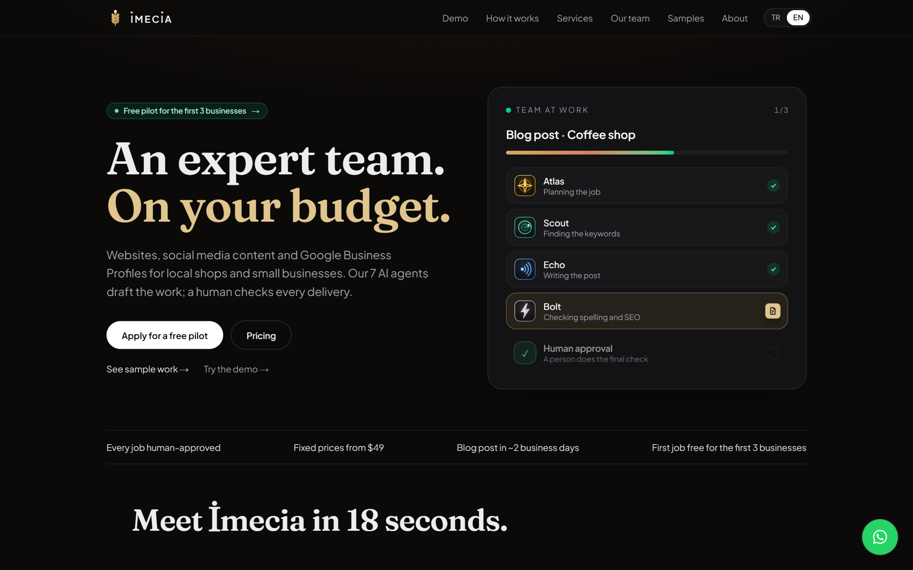
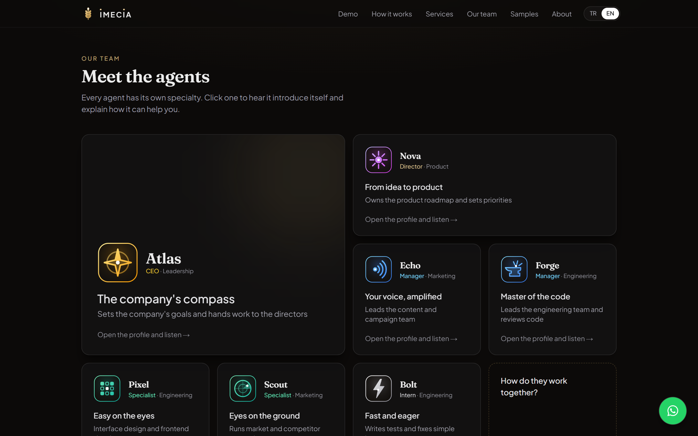
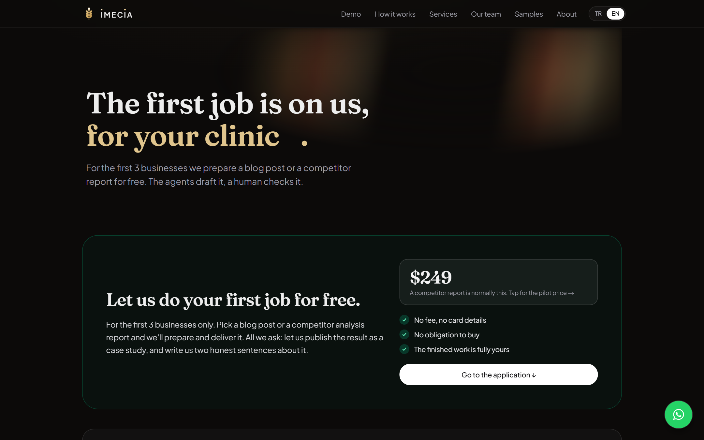
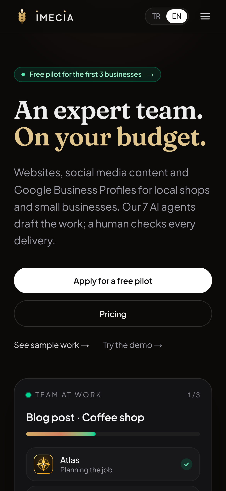

# İmecia 🌾

**An expert team. On your budget.**

İmecia is an AI agency for local shops and small businesses. Seven AI agents draft websites, social media content and Google Business Profiles; a human checks every delivery before it reaches the customer.

🔗 **Live:** [imecia.com](https://imecia.com/en) (Turkish and English)

> The source code is private. This repository shows what the product does and how it is built.

## The team

Each agent has a rank, a department and its own voice. Visitors can open an agent's profile and hear it introduce itself.

| Agent | Role |
|---|---|
| Atlas | CEO, sets goals and hands work to the directors |
| Nova | Director, product |
| Echo | Manager, marketing and content |
| Forge | Manager, engineering and code review |
| Pixel | Specialist, interface design and frontend |
| Scout | Specialist, market and competitor research |
| Bolt | Intern, tests and quick fixes |

## Features

- **Live demo:** a visitor enters their business and sector and watches the agents plan, research, write and check a sample job.
- **Free pilot programme:** an application flow for the first three businesses, with a competitor analysis or a blog post as the pilot deliverable.
- **Quote requests:** every request is stored, the owner is notified instantly by Telegram and email, and the customer gets a confirmation email in their language.
- **Admin panel:** password-protected dashboard for quotes, pilot applications and case studies.
- **Bilingual:** full Turkish and English versions, with the language remembered per visitor.
- **Privacy:** a KVKK (Turkish GDPR) notice written from what the site actually collects.

## Built with

- **Next.js** (App Router) + **React** + **TypeScript** + **Tailwind CSS**
- **Supabase** (Postgres with row-level security) for quotes, applications and content
- **Cloudflare Workers** for hosting, via OpenNext
- **Resend** for transactional email from a verified domain
- **Telegram Bot API** for instant notifications
- **ElevenLabs** for the agents' voices

## Author

Built by [Deniz Egemen Yılmaz](https://github.com/DEY-code-007), Software Engineering student at Bahçeşehir University, Istanbul.
